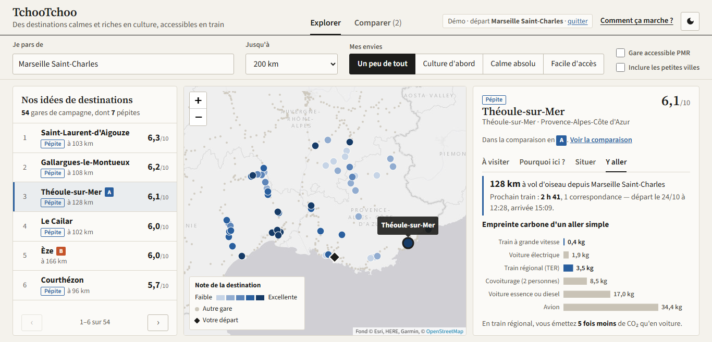
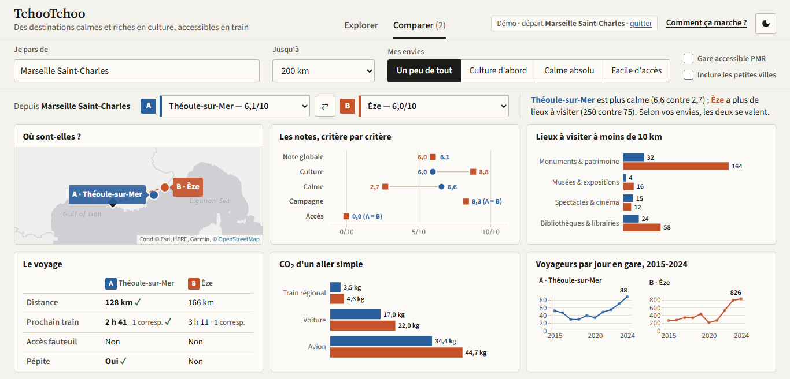

# TchooTchoo — Partez au calme, en train

> **Question métier** : où partir en train pour trouver un endroit calme, à la campagne, avec beaucoup de choses à visiter ?

Mini-projet du cours **Data Visualization** (M2 IA/Data, Ynov, octobre 2026). Il s'appuie sur les défis *Culture* et *Mobilités* de la saison 4 de l'[Open Data University](https://defis.data.gouv.fr/) (association Latitudes et data.gouv.fr).

**Public visé** : tout voyageur, quel que soit son âge ou son aisance avec le numérique. La page tient sur **un seul écran, sans défilement**, dans un style sobre et éditorial (papier, encre, filets fins). Deux vues : **Explorer** pour trouver des idées, **Comparer** pour mettre deux destinations côte à côte depuis le même départ.

**[Documentation de chaque graphique et de chaque calcul](docs/documentation.md)** · [Support de présentation](docs/presentation.md)





---

## 1. Lancer le projet

```bash
# 1. Environnement (Windows : venv.bat fait les étapes 1 et 2)
python -m venv tchootchoo
tchootchoo\Scripts\activate          # macOS/Linux : source tchootchoo/bin/activate
pip install -r requirements.txt

# 2. (optionnel) Clé API SNCF, pour le temps de trajet réel vers la gare choisie
cp .env.example .env                 # puis renseigner SNCF_API_KEY

# 3. (optionnel) Regénérer les données préparées, ~30 s. Le résultat est déjà versionné dans data/processed/
python pipeline/build_dataset.py

# 4. Démarrer le dashboard
python app/backend.py                # puis ouvrir http://127.0.0.1:5000
```

Sans clé API, toute la page fonctionne. Seul le « prochain train » affiche alors un message explicite.
**Démo de la soutenance : `http://127.0.0.1:5000/oral`.** Départ Marseille Saint-Charles, 200 km, comparaison Théoule-sur-Mer / Èze préréglés ; le scénario se modifie dans `DEMO`, en haut de `app/backend.py`.
Autres liens : `?origin=<gare>` pré-remplit le départ ; `#comparaison` ouvre la vue Comparer ; `#pourquoi`, `#situer` ou `#y-aller` ouvre un onglet de la fiche.

---

## 2. Données

| Jeu de données | Producteur | Usage | Fichier |
|---|---|---|---|
| Base des lieux et équipements culturels | Ministère de la Culture | Offre culturelle autour des gares, grille de densité INSEE | `data/base-des-lieux-et-des-equipements-culturels.csv` |
| Accessibilité des gares | SNCF Gares & Connexions | Référentiel des 2 798 gares, coordonnées, accès PMR | `data/accessibilite_gares.csv` |
| Fréquentation en gares 2015-2024 | SNCF Voyageurs | Indicateur de calme / saturation | `data/frequentation_gares.csv` |
| Géocodage inverse | API Adresse (data.gouv.fr) | Commune réelle de chaque gare | `data/gares_communes.csv` |
| Aménagements cyclables | Géovélo / data.gouv.fr | Contexte (non utilisé dans le score) | `data/cycle_stats_by_city.json` |
| Facteurs d'émission | ADEME (impactco2.fr) | Comparaison CO₂ par mode | `app/scoring.py` |

## 3. Traitement (`pipeline/build_dataset.py`)

1. **Commune réelle des gares** : le code INSEE contenu dans l'identifiant NeTEx est erroné pour **3,75 %** des gares. Par exemple, La Barasse, à Marseille, porte le code des Baux-de-Provence. On utilise donc le géocodage inverse.
2. **Fréquentation** : jointure sur le nom normalisé (sans accents ni ponctuation) et le département, avec repli sur le nom seul s'il est unique. **99,75 %** des gares sont appariées.
3. **Offre culturelle** : on compte les lieux à 5 et 10 km de chaque gare (distance de haversine, calcul vectorisé NumPy par blocs). Seules les familles touristiques sont retenues (patrimoine, musées, spectacle, bibliothèques et librairies). On compte aussi les lieux **labellisés** (Unesco, Musée de France, Jardin remarquable, Site patrimonial remarquable, Maison des illustres…).
4. **Ruralité** : grille communale de densité INSEE à 7 niveaux, disponible pour 93,5 % des communes de gare. Pour les autres, on prend le vote majoritaire des lieux situés à moins de 5 km. Ce vote résiste mieux qu'un simple plus proche voisin aux erreurs de géocodage de la source, comme ce conservatoire de Trappes positionné dans l'Oise.

### Note sur 10 (`app/scoring.py`)

Moyenne pondérée de quatre critères ramenés sur 100, puis divisée par 10. Les poids dépendent de l'envie choisie (« Un peu de tout », « Culture d'abord », « Calme absolu », « Facile d'accès ») :

| Critère | Calcul | Poids « Un peu de tout » |
|---|---|---|
| Culture | rang centile de (lieux à 10 km + 4 × lieux labellisés) | 40 |
| Calme | 100 − rang centile des voyageurs 2024 en gare | 30 |
| Campagne | densité INSEE ramenée de 0 (grande ville) à 100 (campagne très peu peuplée) | 20 |
| Accès | 50 (accès fauteuil) + 50 (accès PMR partiel) | 10 |

Une **pépite** est une gare dont les critères Calme et Culture valent tous deux au moins 50.
Le détail des calculs, avec un exemple chiffré, est dans la [documentation](docs/documentation.md#6-les-calculs-en-détail).

## 4. Principaux enseignements

- Avec les réglages par défaut (communes rurales), **1 258 gares** sont retenues, dont **220 pépites**, surtout en Nouvelle-Aquitaine, Bourgogne-Franche-Comté, Bretagne et Hauts-de-France.
- **L'accessibilité est le point faible** : 3,3 % des gares rurales sont accessibles en fauteuil roulant, contre 30,5 % des gares urbaines. Sur les 220 pépites, **une seule** l'est (L'Hermitage - Mordelles). Recommandation : prioriser la mise en accessibilité des pépites.
- **Le classement fin dépend des poids.** Avec des poids égaux, seules 4 gares du top 15 restent en place, contre 28 sur 50 pour le top 50. La note est donc présentée comme une aide pour trouver des idées, pas comme un palmarès.

## 5. Choix de conception

### Stack

| Brique | Pourquoi |
|---|---|
| **Pandas + NumPy** (pipeline) | Préparation reproductible et versionnée, séparée de l'affichage. La page ne dépend plus d'appels API aléatoires. |
| **Flask** | API légère ; elle laisse un contrôle total de la mise en page, indispensable pour tenir sur un seul écran, ce que Streamlit ne permet pas. |
| **Altair → Vega-Lite** | Grammaire des graphiques vue en cours. Les specs sont générées en Python et s'adaptent à la taille de leur zone (`width/height: container`). **Techno nouvelle pour l'équipe**, utilisée hors notebook. |
| **Leaflet** | Carte légère, sans clé d'API, sur fond gris neutre (Esri Canvas) pour réserver la couleur aux données. |

**Style** : sobre et éditorial (Source Serif pour les titres, Source Sans pour le texte, fond papier, filets fins, aucune ombre ni dégradé), pour éviter l'esthétique « dashboard générique » et laisser la place aux données.

Alternatives écartées : Streamlit (mise en page trop contrainte, défilement imposé), Dash (aurait doublé le travail de mise en page sans apport pour la carte), Power BI ou Tableau (outils propriétaires, peu reproductibles, mal adaptés au calcul spatial et à un public grand public).

### Mise en page : une page, zéro défilement

```
Bandeau : nom · promesse · « Comment ça marche ? » · thème
Recherche : Je pars de · Jusqu'à · Mes envies · Gare accessible PMR · Petites villes
┌───────────────┬────────────────────┬──────────────────────────────────────┐
│ Nos idées     │ Carte              │ Fiche : À visiter · Pourquoi ici ?   │
│ (paginée)     │                    │         Situer · Y aller             │
└───────────────┴────────────────────┴──────────────────────────────────────┘
```

- La page occupe exactement la hauteur de l'écran ; la liste affiche autant d'idées que la place le permet (pagination ‹ ›).
- La fiche est découpée en **onglets** : une question par onglet, un graphique au plus par onglet.
- La vue **Comparer** affiche A et B dans six panneaux : carte, notes par critère (haltères), lieux à visiter (barres groupées), voyage (tableau avec prochain train réel), CO₂ (barres groupées), voyageurs par jour (petits multiples), plus un verdict en phrases.
- Les lieux « à ne pas manquer » ne sont affichés que s'ils tiennent entièrement.
- Exception assumée : sur téléphone (moins de 900 px de large), les blocs s'empilent et la page défile, faute de place.

### Bonnes pratiques respectées

- **Lisibilité pour tous** : texte de 16 px, vocabulaire courant (note sur 10, campagne, gare typique), une idée par graphique, valeurs écrites au bout des barres.
- **Rapport encre / donnée** : axes supprimés quand la valeur est écrite, pas de 3D ni d'ombre sur les graphiques, grille réduite aux repères utiles.
- **Forme adaptée à la question** : barres horizontales pour des quantités, jauges pour les critères, nuage simple pour situer une gare, haltères pour un écart A/B, barres groupées pour comparer des quantités, petits multiples pour des évolutions d'échelles différentes (au lieu d'un double axe), carte pour le « où ». Le radar et le nuage en échelle logarithmique ont été retirés : trop difficiles à lire pour le grand public.
- **Couleur porteuse de sens** : bleu ardoise pour la donnée importante et la destination A, terre cuite pour la B (duo validé pour le daltonisme, doublé par les lettres A/B et les formes rond/carré), gris pour le contexte, rampe séquentielle à une teinte sur la carte (quintiles nationaux stables). Les actions restent en noir et blanc.
- **Interactivité** : recherche, envies, options, sélection liée liste ↔ carte ↔ fiche, comparaison A/B (ajout depuis la fiche, menus, inversion), onglets, infobulles, prochain train en temps réel, liens partageables, mode démo.
- **Accessibilité** : contrastes WCAG AA, cibles tactiles de 40 à 46 px, navigation complète au clavier (lien d'évitement, liste en boutons, onglets aux flèches), descriptions des graphiques pour les lecteurs d'écran, thème sombre, `prefers-reduced-motion`, information jamais portée par la seule couleur.
- **Éthique et transparence** : guide « Comment ça marche ? » intégré, documentation détaillée, sources citées, aucune donnée personnelle.

### Écarts assumés

- **Onglets** : une partie de l'information est masquée à un instant donné. C'est le prix du « zéro défilement » ; les onglets restent visibles et nommés par une question.
- **La carte n'est pas entièrement navigable au clavier** ; la liste des idées offre le même accès.
- **Note composite** : elle agrège des grandeurs hétérogènes. Elle est expliquée critère par critère et modulable via les envies.

### Limites

- La fréquentation d'une gare n'est qu'un indicateur indirect de la saturation touristique d'un territoire.
- Les monuments historiques représentent environ 56 % de la base Culture, ce qui avantage les territoires riches en petit patrimoine.
- La page ne tient pas compte de la fréquence de desserte, des horaires d'ouverture ni des capacités d'hébergement.
- Le bilan CO₂ est un ordre de grandeur : distance à vol d'oiseau × 1,2, facteurs moyens ADEME.

## 6. Structure

```
app/
  backend.py      API Flask (/api/meta, /api/dashboard, /api/station, /api/journey, /api/export.csv)
  scoring.py      filtres, score, facteurs CO2
  charts.py       specs Altair + thèmes clair/sombre
  static/         app.js (interactions, carte, vega-embed), style.css (tokens de design)
  templates/      index.html
pipeline/
  build_dataset.py    préparation des données -> data/processed/
  process_cycling.py  agrégation des aménagements cyclables
data/             données brutes + data/processed/ (sorties du pipeline)
docs/             documentation des graphiques et calculs, support de présentation, aperçu
```
